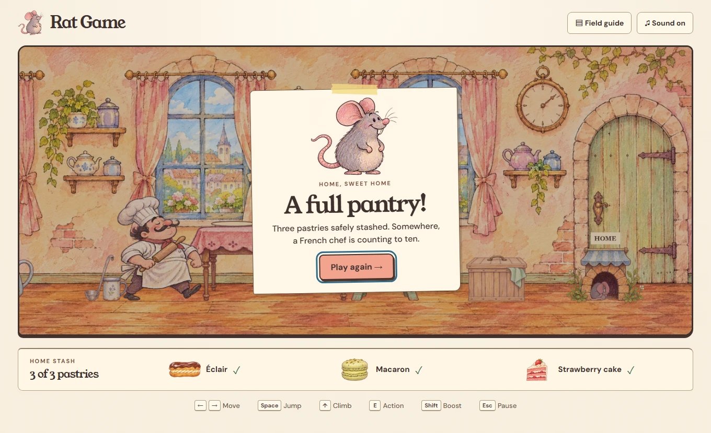

# Rat Game V3 playtest

Tested 8 November 2026 in desktop Chromium on Windows, using the production build. The game also opened from a local HTML file with networking disabled. [Download the playable preview](https://github.com/dtoska1/rat-game/raw/refs/heads/v3-rebuild/preview/Rat-Game-V3.zip).

## A complete kitchen run

The 1360 × 830 keyboard run stashed the éclair at **13.27 seconds**, the macaron at **33.04 seconds** and the strawberry cake at **66.98 seconds** of active simulation time. Each leg began at the hole. The rat jumped onto a stool, climbed a ladder, filled up on samples as needed, picked up one untouched pastry and carried it home. Picking it up left the stash count unchanged until delivery. The final return included a stop inside the flour sack and another inside the teapot. The win screen appeared on the third deposit. These times come from a practiced route that knows every table location. [Read the event log](playtest/route.json).

## Checks and observations

Before the control fix, Up produced no jump on open ground, and a short Space press rose 53 units against an 82-unit stool. From directly underneath, the stool blocked the rat after 36 units. In the updated build, a 20 ms press of Space, W or ↑ from underneath landed on the stool every time. A single touch tap passed the same check in both orientations. Holding a jump adds height. Pressing the opposite direction reverses the rat even while the old key is held. [Desktop jump screenshot](playtest/desktop-jump.webp).

The chef moved toward the rat on first sight and entered full pursuit after 170 ms in the desktop regression run. Nearby unobstructed encounters skip that recognition interval. The winning route used timed jumps to dodge his low grab and the spoon to draw him away.

| Check | Result |
| --- | --- |
| Manual movement | Walking through the furniture kept the rat on the floor. The keyboard and touch routes both required a jump onto the stool and a separate climb onto the table. |
| Food reach and energy | Action directly beneath the éclair hid the rat without affecting food or energy. On top, the rat could not take it at 44%. It could take it after tasting samples to reach 100%. Boost drained energy during movement. |
| Stealth | A teapot blocked a facing chef’s sightline. He walked past a hidden rat. In a second run he saw the rat duck under the table, investigated that spot, searched and caught it. Knocking the spoon redirected him during the winning run. |
| Capture and replay | Three consecutive deaths played the cake sequence. Each replay began in the hole with 44% energy, an empty stash, no cargo and no held controls. Walking worked again. |
| Shortcut and pause | Spawning, holding right and pressing Action 15 times produced zero deliveries. Pause froze simulation time. |
| Phone portrait, 390 × 844 | Simultaneous move and jump, manual climb, tasting, carrying and one home delivery passed. Replaying while a finger was held cleared that input. |
| Phone landscape, 844 × 390 | The same touch route passed. Movement and action buttons fit below the playfield. |
| Standalone preview | Chromium opened the HTML from disk, walked and jumped with networking disabled, and issued zero external requests. |

The test driver sent keyboard and browser touch inputs. Read-only observations supplied positions, chef state and stash counts so the driver could time its next input. No test teleported actors, set energy, forced a death or changed the simulation clock. [Regression checks](playtest/regression.json) · [Portrait log](playtest/portrait.json) · [Landscape log](playtest/landscape.json) · [Offline check](playtest/offline.json).

## Moving-frame measurements

Samples were recorded while walking, boosting or climbing in the kitchen. The interval is the time between Phaser game-loop frames. The CPU measurements bracket the Phaser step and renderer submission. GPU completion and physical display latency were not measured.

| Chromium viewport | Moving frames | Interval median / p95 | Phaser CPU median / p95 | Renderer CPU median / p95 |
| --- | ---: | ---: | ---: | ---: |
| 1360 × 830 | 3,186 | 16.7 / 16.7 ms | 0.5 / 0.8 ms | 0.3 / 0.5 ms |
| 390 × 844 | 503 | 16.7 / 16.7 ms | 0.5 / 0.8 ms | 0.3 / 0.5 ms |
| 844 × 390 | 504 | 16.7 / 16.8 ms | 0.5 / 0.9 ms | 0.3 / 0.5 ms |

In a separate desktop comparison using the same movement and boost inputs, WebGL recorded 33.3 / 50 ms median / p95 frame intervals and Canvas recorded 16.7 / 16.7 ms. The game now defaults to Canvas. An earlier return trip also showed that a boosting rat carrying the cake could not outrun the chef. The revised burst speed and flour-sack cover give that trip an escape route.

Phone-size testing used Chromium and Playwright WebKit on this computer. WebKit registered a thumb tap to jump from home in portrait, then registered another tap to land on the stool after rotation to landscape. [WebKit results](playtest/webkit.json). Physical Android and iOS devices, Safari, thumb reach, thermal slowdown and audible speaker quality still need hands-on checks.

## Screenshots

[Title](playtest/desktop-title.webp) · [Carrying an éclair](playtest/desktop-carry.webp) · [Chef searching](playtest/desktop-search.webp) · [Rat cake](playtest/desktop-cake.webp) · [Portrait touch controls](playtest/portrait-carry.webp) · [Landscape climb](playtest/landscape-table.webp).
